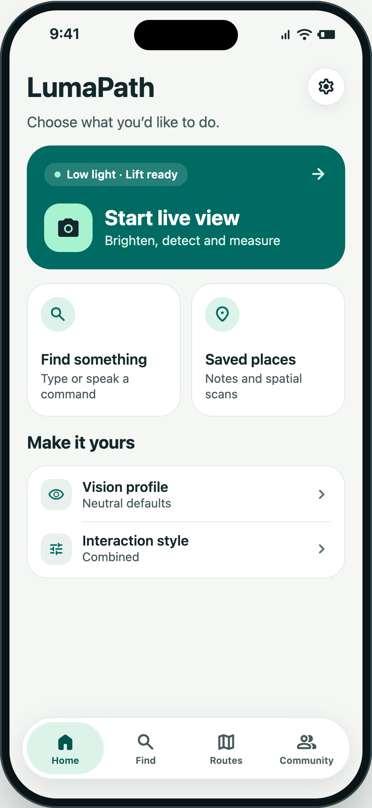
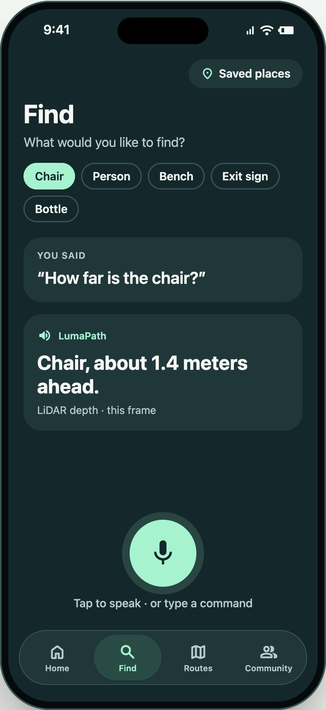
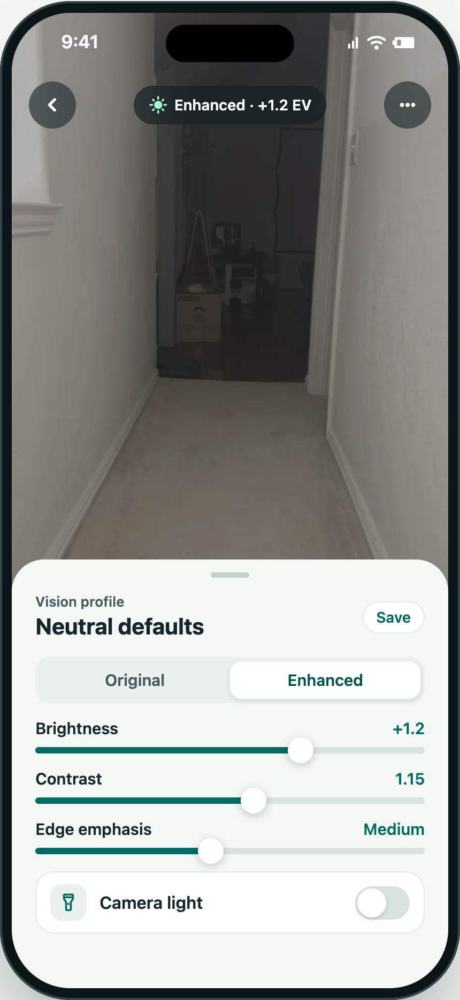
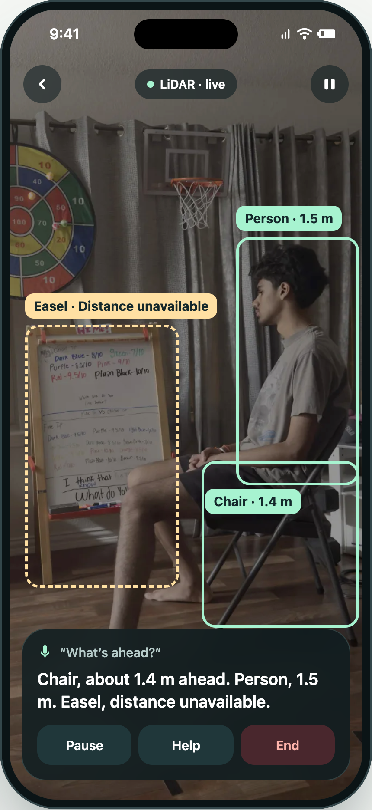
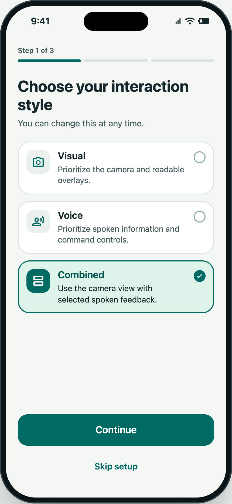
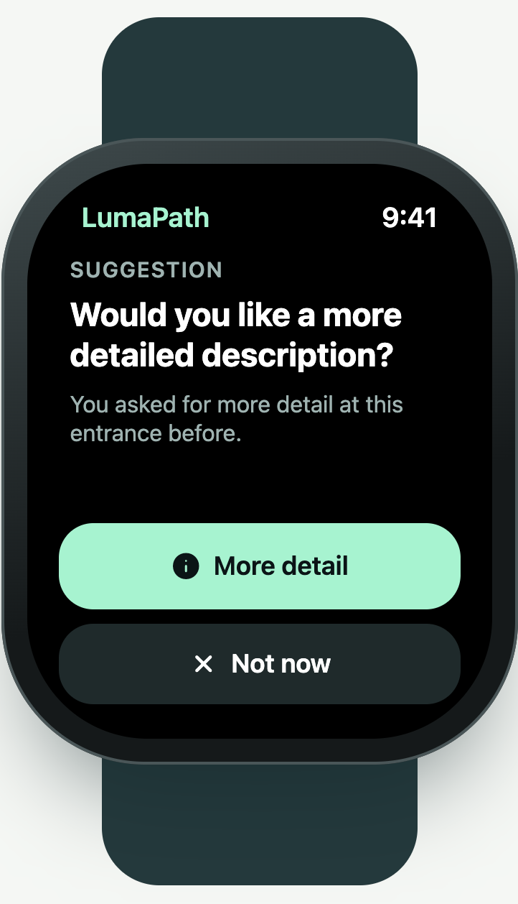

<p align="center">
  
</p>

# LumaPath

**A clearer view of dim surroundings. An honest answer when sensing is uncertain.**

LumaPath is a native iPhone accessibility project for people with low vision. It combines an adjustable camera view, local object recognition, and depth-based distance information on supported hardware, with Visual, Voice, and Combined presentation styles.

Submitted to the **2026 Congressional App Challenge** by **Yajat Parmar, Aarav Bansal, Shrey Gandhi, and Sujay Billakanti**.

    [](https://github.com/yajatp/lumapath/actions/workflows/build.yml)

[Getting started](#getting-started) · [Documentation](docs/README.md) · [Architecture](docs/ARCHITECTURE.md) · [Validation](docs/VALIDATION.md) · [Privacy](docs/PRIVACY.md) · [Credits](THIRD_PARTY_NOTICES.md)

## Why we built it

In a dim room, seeing a shape does not always tell someone what it is or how far away it is. LumaPath explores how an iPhone can make that information easier to access while being explicit about missing depth, stale observations, and unsupported capabilities.

The central principle is simple: **say “distance unavailable” rather than invent a measurement.** Image enhancement changes the preview, while distance comes from supported sensor evidence. Observations expire after 300 ms, and a detected object never certifies a clear or safe path.

## A look inside

LumaPath’s native iPhone interface brings camera tools, Find, saved places, and accessibility preferences together, with light and dark appearances and an optional Apple Watch companion.

<p>
  
  
  
</p>
<p>
  
  
  
</p>

Interface mockups illustrate the native app and Watch companion. Example scenes, measurements, and Watch cues do not represent validated sensing results. Routes and Community remain unavailable. See [validation and limitations](docs/VALIDATION.md).

## What’s included

| Area | Implementation |
| --- | --- |
| Camera and enhancement | Adjustable brightness, contrast, highlights, edges, and bounded low-light preview enhancement; camera-only fallback where available. |
| Local scene research | Bundled YOLOv3 models, frame-matched depth association, stable object readouts, and explicit unavailable states. |
| Accessible interaction | Visual, Voice, and Combined presentation; Dynamic Type; typed requests; on-device push-to-talk where supported; optional phone speech and haptics. |
| Saved places | Local manual notes and experimental protected spatial scans. |
| Apple Watch | Optional foreground Research status, cue previews, and pause controls. The iPhone owns sensing. |
| Research tools | Deterministic replay, synthetic RGB-D room generation, model preparation, offline fusion experiments, and comparative-study accounting. |
| Community infrastructure | A separate Python service for authenticated reports, moderation, privacy-aware projections, and backup/restore tests. Product integration and deployment remain pending. |

**Research prototype:** object recognition, distance sensing, and accessory feedback still require physical and user testing. LumaPath does not provide validated walking guidance. Routes and Community are not available in the app. See [validation and limitations](docs/VALIDATION.md).

## Getting started

### Requirements

- A Mac with Xcode. The recorded development baseline is **Xcode 26.2 / Swift 6.2.3**.
- The iPhone target uses **iOS 17+**; the optional Watch target uses **watchOS 10+**. Compatibility on physical devices still requires validation.
- Live depth requires supported hardware. The simulator can explore UI and synthetic replay.

### Run the app

```sh
git clone https://github.com/yajatp/lumapath.git
cd lumapath
open LumaPath.xcodeproj
```

Select the **LumaPath** scheme and an installed iPhone simulator, then Run. Choose **Start demo** to explore simulated data without camera access. For a physical iPhone, select your own signing team in Xcode. Camera and microphone permissions are requested through explicit actions.

The generated Xcode project is included. XcodeGen is only needed when changing project structure; keep `project.yml` and the generated project in sync.

### Run checks

```sh
swift test
xcodebuild -project LumaPath.xcodeproj -scheme LumaPath \
  -destination 'generic/platform=iOS Simulator' CODE_SIGNING_ALLOWED=NO build
python3 -m unittest discover -s Research/Models -p 'test_*.py'
python3 -m unittest discover -s Research/Fusion -v
python3 -m unittest discover -s Research/Validation -v
python3 -m unittest discover -s Tools/Design -v
python3 -m unittest discover -s Tools/Release -p 'test_*.py' -v
```

See [the validation guide](docs/VALIDATION.md) for service, simulation, native, and UI checks. Core app workflows need no account, API key, or running backend. The optional service has separate [setup instructions](Server/README.md).

## Repository guide

| Path | Contents |
| --- | --- |
| `LumaPath/` | SwiftUI iPhone app, Watch companion, sensing, perception, rendering, feedback, and shared contracts. |
| `LumaPath*Tests/` | Swift package, native, and UI regression suites. |
| `Research/` | Model tooling, offline fusion, synthetic simulation, and study analysis. |
| `Server/` | Optional community-service implementation, migrations, and authorization tests. |
| `Tools/` | Model checks, design-asset generators, routing utilities, and release-evidence audits. |
| `Evaluation/` | Synthetic fixtures, historical technical evidence, and explicit pending acceptance gates. |
| `docs/` | Public guides, interface previews, native simulator captures, and brand assets. |

## Team and acknowledgments

| Team member | Submitted contribution |
| --- | --- |
| [Yajat Parmar (@yajatp)](https://github.com/yajatp) | Camera and depth pipeline. |
| [Aarav Bansal (@HexboxRC)](https://github.com/HexboxRC) | iPhone app and Watch companion. |
| Shrey Gandhi | Saved places and server. |
| Sujay Billakanti | Accessibility and testing. |

**AI assistance:** OpenAI Codex assisted with substantial code generation. The team directed product design, testing, and debugging. See [development credits](THIRD_PARTY_NOTICES.md#ai-assistance).

YOLOv3 models are credited to Joseph Redmon and Ali Farhadi and distributed through Apple’s Core ML model catalog. See [third-party notices](THIRD_PARTY_NOTICES.md) for provenance and licenses.

## Source availability

Source is published for review and reproducibility. No project-wide open-source license is granted. Third-party materials retain their own licenses and notices.
